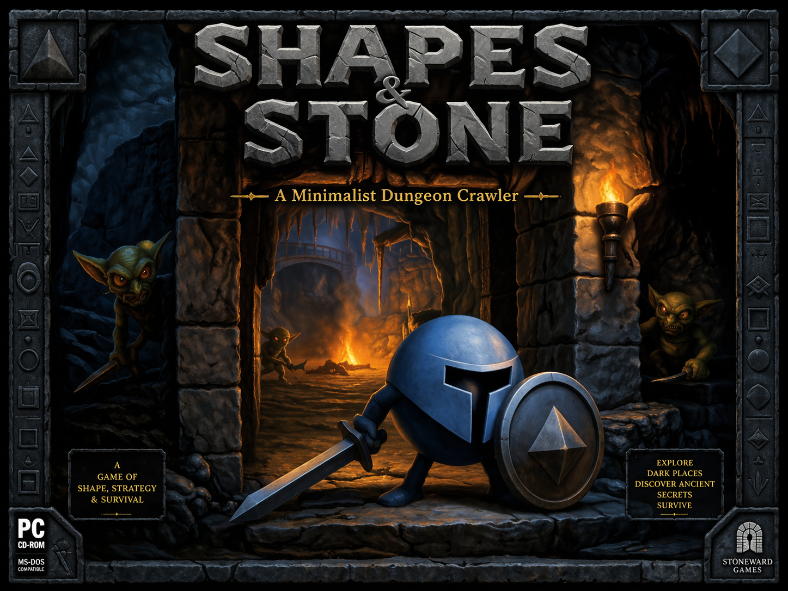

# SHAPES & STONE

*A Minimalist Dungeon Crawler*



---

## PLAY

The game comes as a download for macOS (Apple Silicon), Windows (64 bit) and
Linux (x86_64). Nothing else needs to be installed. The builds are not signed
by Apple or Microsoft, so the system asks once before it starts one.

**macOS:** unzip `ShapesAndStone-macos-arm64.zip` and move
`Shapes and Stone.app` where you like. On the first start macOS says it
cannot check the app: click *Done*, open *System Settings > Privacy &
Security*, scroll down to the message about "Shapes and Stone" and click
*Open Anyway*, then confirm with *Open*. From then on it starts like any app.

**Windows:** unzip `ShapesAndStone-windows-x64.zip` and start
`shapes_and_stone.exe` in the `Shapes and Stone` folder. If "Windows protected
your PC" appears, click *More info*, then *Run anyway*.

**Linux:** make the AppImage executable and start it:

```
chmod +x ShapesAndStone-linux-x86_64.AppImage
./ShapesAndStone-linux-x86_64.AppImage
```

It needs a system at least as new as Ubuntu 22.04, with OpenGL (on
Ubuntu, Debian: `libopengl0`). If it says it needs
FUSE, install `libfuse2` (Ubuntu, Debian:
`sudo apt install libfuse2`), or start it with `--appimage-extract-and-run`.

**Playing together over LAN:** all players are on the same network. One
player chooses *Multiplayer*, picks *LAN*, clicks *Host Game* and tells the
others the LAN code shown. Each of them chooses *Multiplayer*, types the code
and clicks *Join Game*; once everyone is listed, the host clicks *Start Game*.
The first time the host's game opens the network, macOS asks whether to
accept incoming connections and Windows asks to allow access through the
firewall: allow it (on Windows, for private networks), or the others cannot
join.

**In the browser:** open the game's GitHub Pages URL in a current browser;
nothing is installed. The first visit reloads the page once. In the
browser the lobby plays over the internet only: one player clicks *Host
Game* and tells the others the code shown, they type it and click *Join
Game*. A native game that hosts with *Internet* takes browser players too;
a LAN code does not work in the browser.

---

## BUILD

Clayground comes in as the git submodule `clayground/`; its commit is the
Clayground the game builds against.

```
git clone --recursive https://github.com/MisterGC/shapes-and-stone.git
cmake -S shapes-and-stone -B build -G Ninja -DCMAKE_PREFIX_PATH=<Qt>/6.11.1/macos
cmake --build build
```

In an existing clone, `git submodule update --init --recursive` fetches
Clayground.

To start the game headless and fail on any QML warning while it loads - the
check every PR runs (`.github/workflows/build.yml`):

```
ctest --test-dir build -R '^testshapes_and_stone$' --output-on-failure
```

Both knights, yours and the other player's, are drawn by `src/KnightView.qml`.
The knight bench puts the two side by side in the dungeon, makes them swing,
block, parry, get hurt, run their shields low and dry and dash at the same
moment, and saves a PNG per pose (`hurt`, `lowMana`, `shieldBreak`,
`charging`, `heavy`, `whirlwind`, and `sword` and `shield` for the smith's upgrades,
on the local knight only, among them). It needs a window: offscreen it saves
the HUD but not the world.

```
cp build/.qsb/src/shaders/*.qsb src/shaders/
qml -I build/bin/qml tests/knights/knights.qml -- <out dir>
```

The shaders are copied because the bench loads the QML from `src/`, not from
the resources. On macOS the `qml` from the Qt installer refuses the build's
ad-hoc signed plugins; a copy of it signed ad hoc (`codesign -s - --force`)
next to a `lib` link to Qt's `lib` loads them.

A hit shakes, kicks, flashes and hit-stops only the screen of the player who
landed or took it; the other screens draw its sparks and shards only. The
impact bench starts a host and a joiner in one process, joins them over LAN,
lands every kind of hit on each side, then a block alone and a perfect
block alone, then a real hit on the joiner's knight and its shield run
dry - the screen flash, the HP chunk and the mana bar's flash stay on the
joiner's screen, and the host draws the shards - and exits with the number
of failed checks:

```
QT_QPA_PLATFORM=offscreen qml -I build/bin/qml tests/impacts/impacts.qml
```

In a session the host runs every enemy: it spawns them as Clayground
replicated objects (`Network.spawn`, type `"enemy"`), runs their AI and
sends their position, AI state, HP and target. Every other screen shows
the host's enemies in the past by the delay Clayground sizes from the
jitter it sees (the interpolator's auto delay) and runs no AI of its
own. An enemy goes for the nearest knight still standing, on every screen
the same one. A knight's blow on an enemy is drawn and
counted on its own screen and applied by the host; an enemy's lunge or
shot is judged on the screen of the knight it goes for, by that knight's
shield, parry and dash as that screen has them, which applies the HP and
tells the others what became of it. A lunge's blow lands when that screen
shows the lunge land, so a parry there answers it; a shot carries the
host's id, and goes on every screen once the knight's screen has judged
it. The enemy bench
starts a host and a joiner in one process, joins them over LAN, puts a
knight at each of two enemies, compares every enemy on both screens for
five seconds (the joiner shows the parry ring of the host's enemies),
has one of the host's enemies wind up a crushing blow (the joiner shows
its `"crush"` state white-hot with the doubled ring, and its lunge with no
parry window) and the joiner's knight judge one on its held shield,
kills one from the joiner and lets the joiner's knight
fall, and exits with the number of failed checks:

```
QT_QPA_PLATFORM=offscreen qml -I build/bin/qml tests/enemies/enemies.qml
```

The same-world bench checks the same over the network, as a real session
has it: two processes of Clayground's live loader, a host and a joiner,
connected over Local (LAN) or Cloud signaling and started on a fixed seed.
The joiner's knight answers one of the host's enemies: it stands until the
enemy walks into its reach and swings, parries it, blocks, blocks
perfectly and dodges its lunges, blocks, dodges and takes a spitter's shots, shield-pushes it and
kills it while the host's knight kills another. Each answer counts once,
on both screens: the same HP, the stagger of a parry and of a perfect
block, the shove, the death and its
stain, a parried lunge that does not land, each lunge and shot judged by
the joiner's knight and reported to the host, and a shot that goes on the
host's screen when the report arrives. The enemy it answers winds up no
crushing blow: the answers are timed on its parry window, which a
crushing blow does not open. Then both knights fight for
eight seconds while each screen records every enemy it shows - its id, position,
HP and AI state - every frame. It exits with the number of failed checks;
`--fault stale` makes the joiner apply none of the host's enemy states, and
the run fails. It needs the live loader (`-DCLAYGROUND_WITH_TOOLS=ON`, see
the fight bench below):

```
python3 tests/sameworld/run_sameworld.py --mode local
python3 tests/sameworld/run_sameworld.py --mode cloud
```

`docs/multiplayer-sync.md` says what is compared and with what tolerance;
`--dump` and `--judge <file> --late-ms 200` show a joiner 200 ms late fail.

The game starts with its sound on, except in the dojo, and M mutes and
unmutes it. The sound bench starts the game the way a native build does,
enters the dungeon, presses M twice and exits with the number of failed
checks:

```
QT_QPA_PLATFORM=offscreen qml -I build/bin/qml tests/sound/sound.qml
```

At depth 0 a line at the bottom of the screen names the controls: WASD,
LMB strike (hold to charge), RMB shield, Space dash, E talk, 1 potion, 2
draught, M mute and Esc menu.
Esc opens a menu with Resume and Title. Alone it pauses the game: the
world stops, and its first step after Resume is one frame long, so nothing
of the pause is caught up (clayground#338). In a session it pauses nothing, since a host's pause
would stop every player's enemies: the menu says the party fights on and
only this knight stops taking input. Title leaves the run, and a session.
The pause bench checks the hint, the solo pause and its resume, and the
menu of a host and a joiner joined over LAN in one process, and exits with
the number of failed checks:

```
QT_QPA_PLATFORM=offscreen qml -I build/bin/qml tests/pause/pause.qml
```

At 0 HP the knight falls: the enemies stop and a screen shows how deep the
run got, counted in dungeons from depth 0, its kills, the secret rooms
the party found and its time. Enter starts a new run from depth
0 on a new seed, Esc returns to the title. The fall bench brings the knight
down twice, goes again with Enter and back to the title with Esc, and exits
with the number of failed checks:

```
QT_QPA_PLATFORM=offscreen qml -I build/bin/qml tests/fallen/fallen.qml
```

The title, the lobby, the pause menu and the fallen screen take the keys
while they are up, and the game takes them back when the last of them
closes: the knight answers the keys again without a click. A key held when
the menu opens is let go by Clayground's keyboard gamepad (clayground#413),
so the knight stands until it is pressed again. The focus bench sends every
key to whatever has the focus, closes each of these screens, checks that
the game holds the focus and holds D after it, and exits with the number
of failed checks:

```
QT_QPA_PLATFORM=offscreen qml -I build/bin/qml tests/focus/focus.qml
```

In a session a knight at 0 HP is down, drawn slumped and dark on every
screen, and the run goes on while another knight stands: the downed
player's screen says "You are down" and offers only Esc, which leaves the
session. When every knight is down the host ends the run: every screen
shows how far the party got, as the fall screen does for one knight, and
the session stays. The host's screen says "Enter to go again": its Enter
starts the next run for every knight of the session, at depth 0 on a new
seed, with fresh HP, mana, gold and potions and the same colours; nobody
hosts or joins again. A joiner's screen says "Waiting for the host to go
again", and its Enter does nothing. Esc leaves the session for the title.
The downed bench starts
a host and a joiner in one process, joins them over LAN, brings down first
one knight and then the other, twice in turn, leaves with Esc, and exits
with the number of failed checks. Between the two falls the host goes down two levels: at the
village's camp the downed knight rises on both screens and is struck down
again, and in the next dungeon the other screen must make it downed, not
standing until its next state:

```
QT_QPA_PLATFORM=offscreen qml -I build/bin/qml tests/downed/downed.qml
```

A downed knight is not out for good. An ally that stands within
`party.reviveRange` of it for `party.reviveTime` seconds lifts it up: a
ring fills around the fallen knight on every screen, a hit on the ally
starts it over, and the knight rises with `party.reviveHp` of its max HP.
A knight still down when the party reaches the village rises at its camp
with the same share. The fight record counts the allies each knight lifted
(`lifts`) and the times it was lifted (`lifted`). Alone nobody is lifted;
in the dojo `eval fakeDownedAlly()` puts a fallen ally beside the knight,
without a session, to try the lift and the table's `party` group on. The
revive bench checks it over the network: two processes of Clayground's
live loader, a host and a joiner. The joiner's knight falls, the host's
stands beside it and is hit half way, and the joiner's knight must rise
`reviveTime` after the hit with `reviveHp` on both screens; down again, it
must rise at the camp. It needs the live loader
(`-DCLAYGROUND_WITH_TOOLS=ON`) and exits with the number of failed checks:

```
python3 tests/revive/run_revive.py --mode local
```

The go-again bench checks the next run over the network: two processes of
Clayground's live loader, a host and a joiner, connected over Local (LAN) or
Cloud signaling. Three times in one session it takes the party to depth 1,
lets both knights fall, presses Enter on the joiner's screen - nothing
starts - and then on the host's, and checks that both games are at depth 0
on the same new seed with the same enemies, each knight at full HP with no
gold, and that nothing of the run before is left: no enemy, no shot, no
downed knight. It needs the live loader (`-DCLAYGROUND_WITH_TOOLS=ON`) and
exits with the number of failed checks:

```
python3 tests/goagain/run_goagain.py --mode local
```

A session takes players in and lets them go while a run is under way. The
host keeps the run's seed and level as Clayground session properties, so a
player who joins late starts in the host's level, on its seed, with the
host's enemies as they are, and every screen draws the newcomer's knight.
A player who leaves is gone from every screen, and no enemy goes for its
knight any more. A joiner whose host leaves or goes silent is taken to the
title, which says so. The join and leave bench starts a host, a joiner and
a late joiner in one process, joins them over LAN, brings the joiner's knight
down and the host two levels deeper, lets the late joiner in, out again, and
then the host leave, and exits with the number of failed checks:

```
QT_QPA_PLATFORM=offscreen qml -I build/bin/qml tests/joinleave/joinleave.qml
```

A killed enemy drops gold where it fell, by its tier (`loot` in the balance
table); the fight room drops none. The first knight to reach a drop picks
it up, whoever dealt the killing blow, and the HUD shows "Gold N" under the
depth. In a session the host owns the drops as it owns the enemies: it
spawns each as a Clayground replicated object (type `"gold"`), a node
claims the drops its own knight reaches, and the host gives each to the
first claim it gets and despawns it, so a drop is picked up once, by one
knight; each knight's gold is its own node's. In the village the
innkeeper sells a health potion and a mana draught, and the smith
upgrades that last the run, through the dialogue panel: E talks, 1 to 4
buy what the panel offers, each ware named with its effect. Outside the
panel, 1 drinks a potion and 2 a draught, which gives `shop.draughtMana`
mana back, up to the knight's max - at today's 40 it refills the bar; a
knight with full mana drinks none. The campfire stays the healer.

The smith's upgrades have levels, I to III: the sharpened sword adds
`shop.swordAtk` to the knight's attack and shows a brighter, wider blade
edge; the reinforced shield lets `shop.shieldBlockedShare` of a blow
through a held block instead of `knight.blockedShare`, a blow it stops
costs `shop.shieldBlockMana` mana instead of `knight.blockMana`, and shows
a lighter rim; the lighter harness makes a dash cost `shop.harnessDashMana`
instead of `knight.dashMana`, the whirlwind's dash too; the balanced blade
makes a whirlwind cost `shop.bladeWhirlMana`, its dash included, instead
of `knight.whirlMana`. Each of these is a list with one entry per level.
The perfect block's window is the same at every level. At each camp the
smith sells one level, the next above the knight's in one of the four,
for `shop.upgradePrice` of that level, and then nothing more there; the
camp after depth d sells level L only once d reaches `shop.levelDepth`
of L - level I from the first camp, II from the camp after depth 2, III
from the one after depth 4. The knight reads its levels live, so in the
dojo's fight scenario `eval player.swordLevel = 2` (or `shieldLevel`,
`harnessLevel`, `bladeLevel`; 0 for none) applies one at once. Gold,
potions, draughts and the levels go with the knight to the next level; a
new run starts without them. In a session they are each knight's own,
bought with its own gold. Prices and effects are the table's `shop`
group. The gold bench brings one knight to
a drop, to the innkeeper and the smith - it buys the sword, is refused the
shield at that camp, and in the next run buys the shield, blocks a 20-attack blow and
measures the drain - then a host and a joiner joined
over LAN to three drops, one with both knights on it, and exits with the
number of failed checks:

```
QT_QPA_PLATFORM=offscreen qml -I build/bin/qml tests/gold/gold.qml
```

While a dialogue is open the knight stands: movement and the dash do
nothing, so it cannot walk off or take the stairs with the panel still up,
and a key held when the panel closes moves it again. Esc closes the
dialogue; only without one it opens the menu. The dialogue bench talks to
the innkeeper, holds D and presses Space with the panel up, walks on once
it closes, closes it again with Esc, and exits with the number of failed
checks:

```
QT_QPA_PLATFORM=offscreen qml -I build/bin/qml tests/dialogue/dialogue.qml
```

At the camp the witch reads the next dungeon: where it sits in its depth's
range - high, in the middle or low - and what lives there, how many
enemies, how many of them tough and weak, how many guardians and
spitters, and when it hides a secret room that a hidden chamber lies
below and how to find it. She reads it off the run's seed, the next
dungeon's position and the knights the party has, the way the dungeon is
built (`Game.foretell`, `Game.secretsOf`), so the dungeon the knights
walk down into holds what she said; one more press of E per line. In a session every knight hears
the same reading: the seed, the position and the knights are the host's.
The camp bench, on the dojo's seed, takes one knight out of a dungeon
three times - little, half and most of its HP lost - and checks the
witch's reading against the dungeon it then walks into; buys a draught
and drinks it in the next dungeon; buys the harness I at the first camp,
is offered no harness II at the next, dashes with it two dungeons later
and buys the harness II at the camp after depth 2; then a host and a
joiner joined over LAN hear the same reading, buy on their own gold and
find what she read on both screens. It exits with the number of failed
checks:

```
QT_QPA_PLATFORM=offscreen qml -I build/bin/qml tests/camp/camp.qml
```

The camp is a cave, not a box: its outline has bays and outcrops and cut
corners, drawn from a stream of its own (the level's seed ^
`camp.seedSalt`), so the same seed builds the same cave on every screen
of a session. It is about 1.5 times the old 20 x 20 cells, and sits
right under the top of the map, so the walk from where the knights come
in to the stairs stays at most `camp.maxWalk` seconds. Rock overhangs its
north-facing edges, with stalactites and their shadows on the floor. The
tavern and the smithy are walls of whole cells, with faces and rims, and
cast shadows from the campfire. Every number is in `Balance.camp`. The
cave bench builds the camp on 20 seeds and checks the outline's size and
that it is no box, that 20 seeds build 20 outlines and another screen
the same ones, the walk at move speed - and walks the knight to the
stairs along it - where the campfire, the innkeeper, the smith and the
witch stand, and that the buildings block the light and the campfire's
light reaches them and casts shadows. It exits with the number of failed
checks; with a window and an output directory it also saves the outline
and the camp of three seeds and the buildings' shadows as PNGs:

```
QT_QPA_PLATFORM=offscreen qml -I build/bin/qml tests/cave/cave.qml
qml -I build/bin/qml tests/cave/cave.qml -- <out dir>
```

The camps are the stations of the way down, and their look follows the
depth: down to depth 2 a mossy grotto (green earth, moss over the rock,
a pond, ferns, glowing mushrooms, fireflies), from depth 3 a miners' hall
(ochre ground, rock strata between timber props, a rail track and its
cart, crates, ore, dust in the lantern light), from depth 6 an ember camp
(basalt ground and columns, glowing cracks and coals, embers in the
air). Each look has its own rock, faces, floor, lanterns, air and screen
grade, and its props are one of two or three layouts, picked from the
level's seed (`camp.propSalt`), so every screen of a session lays out the
same. A prop lies whole on the cave's floor, off the way to the stairs,
the campfire and the people, and is only drawn: the knights walk over
it. The campfire stays the brightest light, and the campfire, the
innkeeper, the smith and the witch keep their places at every depth.
The looks are a table in `Balance.camp.looks`: a fourth is a row with
its depth, its colours and its layouts. The camps bench lands at every
depth from 0 to 12, checks each look on 12 seeds and has another screen
build the same camps; with a window, the copied shaders and an output
directory it saves each look at two seeds, whole and at the campfire:

```
QT_QPA_PLATFORM=offscreen qml -I build/bin/qml tests/camps/camps.qml
qml -I build/bin/qml tests/camps/camps.qml -- <out dir>
```

In the dojo, `applyScenario("village", d)` lands in the camp after depth
d: 0 the grotto, 4 the hall, 7 the ember camp.

A knight that stands still `camp.sitAfter` seconds (3) in the campfire's
warmth, its heal radius, sits down facing the fire: it sinks a little,
breathes slow and deep, and its shield lies on the floor beside it. Any
movement key, a swing, the shield or a dash stands it up in the physics
step it comes, and the knight moves in that step, so sitting never holds
anyone. It is the look only: the fire heals and refills the same, seated
or not. In a session the knight sends "sit" and "stand" as it sends a
swing, and every screen shows it seated, facing the fire there. The pose's
numbers are `camp.sit`. The sit bench steps the world one physics step at
a time: the knight sits on the step that reaches sitAfter, a press of D,
Space, the right button or a click each stands it up in the next step,
out of the fire's warmth it never sits, and five seconds at the fire heal
and refill the same seated as for a knight that never sits. It exits with
the number of failed checks; with a window and an output directory it
saves the knight seated as `sit.png`. The danger party bench below sits
both knights of a two-process session at the first camp's fire and checks
both screens show them seated, then one walking off and standing up:

```
QT_QPA_PLATFORM=offscreen qml -I build/bin/qml tests/sit/sit.qml
qml -I build/bin/qml tests/sit/sit.qml -- <out dir>
```

The camp's sounds sit where they come from: the campfire crackles in every
camp, the anvil rings while the smith stands at it hammering, water drips
at the grotto's pond, the cart creaks in the miners' hall and the embers
hiss at the ember camp's coals and cracks. Each screen hears them by its
own knight's distance, quieter the further, silent from a sound's reach
on; Clayground's sound is mono, so there is no left or right. When every
knight in the camp has stood still `camp.restQuiet` seconds (10) - all of
them seated by the fire - the camp music steps down to `restMusic` of its
level and the near sounds come forward; a knight that moves brings the
music back. M mutes all of it. Every number is in `Balance.camp.sounds`;
the samples are made by `tools/camp_sounds.py`. The camp sound bench
steps the world: the crackle's gain falls from beside the fire to the
cave's far edge, the music holds until restQuiet, steps down and comes
back on a press of D, the anvil rings only while the smith hammers, each
look has its own sound on 12 seeds, and M silences it all. The danger
party bench checks two screens: each hears the crackle by its own knight,
and the music steps down on both only while both knights rest:

```
QT_QPA_PLATFORM=offscreen qml -I build/bin/qml tests/campsound/campsound.qml
```

Moths circle the campfire and every lantern in slow, uneven loops, now
faster, now slower, the loop swelling and shrinking, their wings beating.
Each look has its own: pale green-white and many in the grotto, dusty
and gathered at the fire in the miners' hall, few and ash-coloured in
the ember camp. All of them are one shader pass (`Moths.qml`,
`shaders/moths.frag`), as the fireflies are: no item per moth. On top of
its flicker the camp's light breathes: the fire's and each lantern's
light swells and sinks over five to eight seconds, each on its own
breath. Only the brightness breathes, never the reach; the heal radius
is the fire's own, and the fire stays the brightest light. The moths and
the breaths come from the level's seed (`camp.lightSalt`), so every
screen of a session sees the same; their numbers are `camp.moths`,
`camp.breath` and each look's `moths`. The moths bench checks one moth
layer per camp at the fire and the four lanterns with its look's moths,
that more moths add no item, that the light breathes while its radius
and the heal stay put, that a dungeon's torches do not, and that
another screen builds the same:

```
QT_QPA_PLATFORM=offscreen qml -I build/bin/qml tests/moths/moths.qml
```

In most camps a cave cat sleeps curled by the campfire, a few soft
shapes breathing slowly. When a knight comes within `notice` wu (3) it
lifts its head and follows the knight with its eyes; once no knight has
been within `forget` wu (4) for `settle` seconds (1.5) it tucks its head
back in; now and then, asleep, it stretches. A knight that sits down by
the fire lets it sleep. It lies on a ring round the fire, out of the
warmth where the knights sit, on the floor and clear of the way to the
stairs, the people and the props. It is drawn only: nothing collides with
it, nobody talks to it, nothing depends on it. Whether it is there and
where it lies come from the level's seed (`camp.catSalt`), so every
screen of a session sees the same cat or none, and each screen sees it
look up at whichever knight comes near. Its numbers and colours are
`camp.cat`. The cat bench checks on 20 seeds in each look that most camps
have a cat and not all, where it lies, that it is no body, npc or prop,
and that another screen places the same; then that it looks up at a
knight coming near, follows it round, settles after the knight leaves,
sleeps by a seated knight, watches the nearer of two knights and stops
its stretch when woken. The danger party bench checks the same cat on two
screens, and on both it looks up at the host's knight:

```
QT_QPA_PLATFORM=offscreen qml -I build/bin/qml tests/cat/cat.qml
```

The cat is made from a creature template, `src/Creature.qml`, for the
camp's next creatures (bats, fish, a salamander). The template does the
watching: every `tick` seconds it asks the game for this screen's knights
(`Game.knightsHere()`), turns `mood` from `"idle"` to `"alert"` when a
standing knight is within `notice` wu, and back once none has been within
`forget` wu for `settle` seconds. It hands its shapes a few numbers to
draw by: `lift` (0 idle to 1 alert, eased over `rise` and `fall`
seconds), `lookX` and `lookY` (the way to the knight it watches),
`breathing` (-1 to 1, one breath every `breath` seconds) and `act` (0 to
1 and back while its idle act plays, every `act.every` seconds, for
`act.seconds`; a knight coming ends it). A new creature is a QML file
`Creature { creature: "bat"; numbers: Balance.camp.bat; ... }` with its
shapes reading those numbers (`src/CaveCat.qml` is the example), a group
of numbers in `Balance.camp`, and a place in `Game.generateVillage`,
drawn from its own stream (the level's seed ^ its own salt) like
`_placeCat`. A creature of a few shapes can be QML items, as the cat is;
a swarm (bats, a shoal of fish) is one shader pass, as the moths are.

One to three travellers rest at the camp, other adventurers on their
way: a Wanderer, a Pilgrim, a Minstrel, a Prospector or a Hermit, each a
shape in its own colour. Each sits at the fire, wanders to a prop of the
look - the grotto's pond, the hall's cart, the ember camp's coals or
cracks - and back. Now and then two of them exchange a pair of lines in
speech bubbles ("Heard the slits on four fire in threes." / "Then dash on
the third."), and a dog, a creature like the cat, follows one of them.
E at a traveller gives two lines of hearsay about the depths; they sell
nothing, and the knights walk through them. Who comes, where each sits
and wanders, its hearsay and the order of the exchanges come from the
level's seed (`camp.travellerSalt`), so every screen of a session sees
and hears the same; when each exchange comes is each screen's own. A
traveller's `objectName` is `"traveller"`, not `"npc"`, so the benches
that look for the innkeeper, the smith and the witch never find one. The
kinds, the lines, the hearsay and the numbers are `camp.travellers`: a
new line or kind is a row there. The travellers bench checks on 20 seeds
in each look who comes, where they sit, their hearsay and the dog, that
another screen picks the same, that two travellers exchange a pair of
lines within a minute of a knight standing by the fire, that E gives the
hearsay and no wares, and that the dog follows its traveller:

```
QT_QPA_PLATFORM=offscreen qml -I build/bin/qml tests/travellers/travellers.qml
```

A descent gauge under the minimap shows how deep the knight is: a shaft of
rock layers, one per depth, darker and hotter the deeper, with the
knight's marker in its layer and "Depth N" beside it; a village counts as
the depth of the dungeon before it. At the camp the gauge is large and the
marker sinks into the next layer, the next dungeon's. It shows the depth
only, never the danger's spot in the depth's range; its colours, sizes and
timing are the table's `gauge` group. In a session every screen shows the
party's depth. The gauge bench saves the dungeon at depth 0, 5 and 15 and
the camp after depth 5 as PNGs (`depth0.png`, `depth5.png`, `depth15.png`,
`camp.png`) and checks the marker and the layers' colours; the gauge is
HUD, so offscreen it is saved too, the dungeon behind it only with a
window and the copied shaders:

```
qml -I build/bin/qml tests/gauge/gauge.qml -- <out dir>
```

The fallen screen shows the run's depth, the run's kills and its time
(simulated, so a pause holds it), the record and this session's runs.

The score of an evening is depth. The record is the deepest descent: its
depth, the knights' lobby names and the date, "Record 12 • Ana, Bo •
2026-10-10". It shows on the title, in the lobby, under the depth on the HUD
("record 12") and on the fallen screen. Alone it is this machine's record,
under the name the lobby keeps for this knight ("Knight" until it is
edited). In a session the host's record is the party's: the host sets it
as a session property and every screen shows it; each node sends its
knight's name to the host, which sets them all as one. When a run goes
deeper than the record it started with, the banner "New record" goes up
over the dungeon on the step the depth passes it, once per run, with a
chime - on every screen of a session, at the host's word - and the fallen
screen says "New record". The record is kept with `Clayground.Storage`
(`KeyValueStore` "ShapesAndStone", key `record`, its depth alone under
`bestDepth`, the name under `playerName`) as soon as a run gets deeper, not
only when it falls; a joiner keeps the party's descent in its own record
too, without a banner of its own. In the browser it survives a page reload:
Clayground's `KeyValueStore` keeps it in the browser's IndexedDB
(clayground#341). The fallen screen lists every run of the session with its
depth and time, newest first: alone the runs since the game started, in a
session the host's since it was hosted. The banner's timing and the chime
are the table's `record` group.

The depth bench runs twice, as two processes, so the record crosses a
restart; each run exits with the number of failed checks. The record bench
puts a record in its store, plays a run that reaches it and one that passes
it - the banner goes up once, on the step depth 3 passes depth 2, and the
new depth is stored with the knight's name - and one that falls short, and
checks the title, the HUD and the runs on the fallen screen; with an out
dir and a window it saves `title.png`, `hud.png` and `fallen.png`. The
record party bench plays it in a session of two processes, each with a
record of its own: both lobbies and HUDs show the host's record, both
screens raise the banner once, both fallen screens list the same runs, and
the joiner's own record stays as it was. It needs the live loader
(`-DCLAYGROUND_WITH_TOOLS=ON`):

```
QT_QPA_PLATFORM=offscreen qml -I build/bin/qml tests/depth/depth.qml -- first
QT_QPA_PLATFORM=offscreen qml -I build/bin/qml tests/depth/depth.qml -- second
QT_QPA_PLATFORM=offscreen qml -I build/bin/qml tests/record/record.qml
qml -I build/bin/qml tests/record/record.qml -- <out dir>
python3 tests/recordparty/run_recordparty.py --mode local
```

Every fight number - HP, damage, timings, cooldowns, spawn counts, the heal
rate, the gold a kill drops and the village's prices - sits in one table,
`src/Balance.qml`; tuning the fight is an edit of that file. In the dojo's inspector, `eval JSON.stringify(Balance)` returns
the whole table (a bare `eval Balance` returns `null`: the inspector does
not turn objects into JSON). The balance bench checks that the knight, the
enemies, the fight room and the campfire carry the table's values, and exits
with the number of failed checks:

```
QT_QPA_PLATFORM=offscreen qml -I build/bin/qml tests/balance/balance.qml
```

Deeper is harder. Each dungeon is a depth, counted from 0, and the table's
`depth` group says what each depth adds to the dungeon: two more enemies
(up to `depth.enemiesCap`), fewer weak and more tough ones, more guardians
and spitters, and half an attack point per enemy, rounded. A dungeon's
tier mix is dealt, not rolled: `spawn.weakChance` of its enemies are weak
and those above `spawn.normalChance` tough, so the mix follows the depth on
every seed. In the dojo, `applyScenario("dungeon", 4)` through `eval` lands
in the dungeon at depth 4 (the village and the fight room take a depth the
same way), and the balance bench checks depth 0, 2 and 4 against the table.

Each depth is a range of difficulty, and how the last dungeon went picks
the spot in it. A dungeon's danger is its depth plus a position in [0, 1),
and the `depth` group adds per step of the danger, a share of a step
between two. Leaving a dungeon moves the position half way (`danger.pull`)
toward what it earned: 1 less the share of max HP lost in it - a potion's
heal does not take the loss back - or 0 after a fall. Little lost puts the
next dungeon high in its depth's range, much lost low, a fall lower still;
a descent is always harder, since the next depth's range starts where this
one's ends. The position goes on into the next run, not past a restart: a
fresh game starts at `danger.start`, 0.5. In a session the host settles it
from every knight's record: the losses averaged, and one knight's fall is
the party's. `applyScenario("dungeon", 4.8)` lands high in depth 4's range.

More knights meet more resistance. The host builds each dungeon for the
knights in the session: each knight beyond the first adds
`party.enemiesPerKnight` enemies to the spawn table, on top of what the
danger adds and within `depth.enemiesCap`, and `party.hpPerKnight` of every
enemy's HP - two more enemies and a quarter more HP per knight. Alone a
dungeon is as it was. A knight joining or leaving mid-dungeon changes the
next dungeon, not the one the party is in; the village's fight room stays
the same for any party. In the dojo, `eval knightsOverride = 4` and then
`eval applyScenario("dungeon", 2.5)` build that dungeon for four knights,
and so the next dungeons, until `eval knightsOverride = 0` counts the
session's knights again; `eval partyKnights` says whom the dungeon is built
for. The party size bench builds the same seed and
danger for 1, 2 and 4 knights and checks the enemies against the table,
and the 1-knight dungeon against the one recorded before:

```
QT_QPA_PLATFORM=offscreen qml -I build/bin/qml tests/partysize/partysize.qml
```

The dungeon shows its danger (`danger.looks`): low danger has warm torches,
clean stones and dust in the air; middle fewer, cooler torches, cracks,
moss and old stains; high ember-red torches, cracked stones, bones and
glowing embers, embers in the air too. The exit stairs glow in the next
dungeon's torch colour: in a dungeon where it would stand were the party to
leave now, in the village where it stands. The danger bench feeds made-up
records and plays a descent, and builds the same seed at the same danger
twice; the looks bench saves the same dungeon at low, middle and high
danger and the stairs at a high and a low next one as PNGs, and needs a
window and the copied shaders, like the knight bench; the danger party
bench plays four dungeons in a session of two processes, the host
settling each next one from both knights' records and building it for two,
and checks that both screens' gauges show the same depth, at each camp and
in each dungeon, that both build the same camp in its depth's look, with
the same cat or none, and that at the first camp the cat looks up at the
host's knight on both screens and both show the knights sit down by the
fire and one stand up again (`--shots` saves both screens of the first three camps and
of the knights seated too):

```
QT_QPA_PLATFORM=offscreen qml -I build/bin/qml tests/danger/danger.qml
qml -I build/bin/qml tests/looks/looks.qml -- <out dir>
python3 tests/dangerparty/run_dangerparty.py --mode local [--shots <out dir>]
```

A dungeon's rooms are joined in a chain, the start room to the exit's,
and some get a second entrance: `dungeon.extraCorridors` more corridors,
one at low danger, two at middle and three at high, each between two
rooms close but not neighbours in the chain, so a dungeon has loops to
flank and to escape (`Game.addLoops`). They come from their own stream of
the level's seed, so the rooms, the enemies and the witch's reading stay
as the seed has them, and every screen of a session carves the same. Each
is drawn from the `dungeon.loopChoice` closest pairs left and carved
L-shaped, centre to centre, as the chain's corridors are; one that would
cut through or open into a third room, run along one of its own rooms'
walls, or run into the entrance's or the exit's shaft is passed over. The
exit stays reachable and the entrance blocked. The loops bench checks the
table, that a seed and danger carve the same corridors twice, and walks
50 seeds for the rules: every room and the exit reachable, as many
corridors as the table asks, none through or into a third room, along a
wall or into a shaft, each closing a loop. With an out dir and a window it
saves `loops.png`, the game's minimap of a dungeon with three loops, all
of it explored, beside the same grid with its corridors off the chain in
amber:

```
QT_QPA_PLATFORM=offscreen qml -I build/bin/qml tests/loops/loops.qml
qml -I build/bin/qml tests/loops/loops.qml -- <out dir>
```

A dungeon's features - what the knights read, use, find or break - are
laid out once its rooms and corridors are carved (`Game.planFeatures`),
each kind from its own stream of the level's seed and its name, so the
rooms, the enemies, the torches and the debris stay as the seed has them,
and a kind added or retuned moves another only off a cell it takes first.
Every feature stands on a room's cell, never in the start room, on a
doorway or on a corridor's cell, at least `dungeon.clearOfEntrance` wu
from the entrance and `dungeon.clearOfExit` wu from the exit, one to a
cell. How many of a kind each room but the start room holds is the
table's `dungeon.kinds`, per danger band as the looks have it. The kinds
are the breakables, the spike plates and the arrow slits below; a slit stands
only on a cell on the room's edge with a wall beside it. In
the dojo `applyScenario("features")` lands in a dungeon with every kind at
its showcase count, and `applyScenario("features", 2.5, 77)` at a danger
and on a seed; the next level is built without it. The features bench
checks that the scenario places every kind and shows its breakables, that
a seed and danger place the same features twice and the scenario seed's
as recorded, that a kind laid out before the urns moves them only off the
cells it takes, and walks the
grid of 50 seeds for the rules; with an out dir and a window it saves
`features.png`:

```
QT_QPA_PLATFORM=offscreen qml -I build/bin/qml tests/features/features.qml
qml -I build/bin/qml tests/features/features.qml -- <out dir>
```

Clay urns, wooden crates and barrels and crystal clusters stand on their
features' cells (`src/Breakable.qml`), coloured by the dungeon's look, the
crystals glowing; a crystal is rarer the shallower. An urn and a barrel
stand upright, drawn from the side on a shadow of their own, smaller than
a knight: they block a square of `dungeon.standing`'s `foot` wu and rise
`tall` wu. Each blocks the knights and the enemies like a small wall, a
crate and a crystal a square of `dungeon.breakableSize` wu, not the
shots, and casts no shadow; the
enemies' paths go around it. A swing breaks the nearest one in its arc, a
charged swing and the whirlwind every one they reach. Only a charged swing
breaks a crystal: a swing glances off it with sparks, the whirlwind passes
it. A broken thing may hold gold, by its kind's row in `dungeon.loot`: a
chance, an amount from `gold[0]` to `gold[1]` and `perDepth` more a depth,
a crystal more often and more than an urn or a crate. The roll comes from
the level's seed and the thing's cell, whoever breaks it, and the gold
drops where it stood, a drop as an enemy's. In a session a blow breaks the
thing at once on the screen that dealt it; the host rolls its gold, spawns
the drop and keeps the cells broken in the level as the session property
`broken`, so every screen breaks it too, a player who joins later as well,
and the drop is picked up once. The heaps of bones still break on the
breaker's screen only, with no gold. The breakables bench walks the knight
into a crate, breaks each kind with its swing, a swing's nearest of three
urns and a charged swing's other two, three crates with the whirlwind,
then every thing of the features scenario, and checks each drop against
the table on the scenario seed and the gold of 40 seeds against the
chances and ranges; with an out dir and a window it saves
`breakables.png`, an urn, a crate, a barrel and a crystal whole, and
`breaking.png`, a charged swing breaking them:

```
QT_QPA_PLATFORM=offscreen qml -I build/bin/qml tests/breakables/breakables.qml
qml -I build/bin/qml tests/breakables/breakables.qml -- <out dir>
```

The break party bench checks it over the network: two processes of
Clayground's live loader, a host and a joiner, on a fixed seed. Both stand
the same breakables; the joiner's knight breaks one that holds gold, and
it must be gone on both screens with the same drop where it stood; both
knights step onto the drop and one of them gets it; the host's knight
breaks a crystal, gone on the joiner's screen too. It needs the live
loader (`-DCLAYGROUND_WITH_TOOLS=ON`) and exits with the number of failed
checks:

```
python3 tests/breakparty/run_breakparty.py --mode local
```

A spike plate is a floor stone with small holes in it on its feature's
cell (`src/SpikePlate.qml`), always the same, coloured by the dungeon's
look; it does not block. A knight whose centre steps on it makes it
click, and `dungeon.spikeDelay` seconds later its spikes rise: a knight
still on it, and not dashing, takes `dungeon.spikeDamage` and
`spikeDamagePerDepth` more a depth, never more than `spikeCap` of its
max HP (`Game.spikeDamageAt`); no defence, shield or grace takes any of
it. Then the plate stays sprung, bent spikes over a stain, and never
fires again. The enemies walk over it. Alone the delay runs on the
physics clock, so the dojo's pause holds it. In a session the knight's
game that sets a plate off reports it and the moment its spikes rise on
the session clock to the host, which keeps the plates set off in the
level as the session property `sprung`; every other screen clicks and
raises that plate at that moment, a player who joins later sees it
sprung, and each game judges the spikes on its own knight alone. The
spikes bench lands in the features scenario, checks its plates and that
laying them out moved another feature only off a cell a plate took,
stands an enemy on a plate, which stays armed, and the knight on
another: it clicks, the spikes rise `spikeDelay` later and take what
`spikeDamageAt` says, and the plate fires once. A knight that dashes
at the click takes nothing; the damage stays under the cap from depth 0
to 60, and at depth 0, 3, 8 and 20 the spikes take that much. With an
out dir and a window it saves
`plates.png`, a plate armed beside one sprung, and `rising.png`, the
spikes rising under the knight:

```
QT_QPA_PLATFORM=offscreen qml -I build/bin/qml tests/spikes/spikes.qml
qml -I build/bin/qml tests/spikes/spikes.qml -- <out dir>
```

The spike party bench checks it over the network: two processes of
Clayground's live loader, a host and a joiner, on a fixed seed. Both lay
the same plates; the joiner's knight stands on one, its own game takes
the damage and the host's screen shows the plate sprung and the joiner's
HP as the joiner's game has it; the same the other way round; a knight
that dashes at the click takes nothing; two knights on one plate each
take the damage once, and a plate stepped on again does nothing. It
needs the live loader and exits with the number of failed checks:

```
python3 tests/spikeparty/run_spikeparty.py --mode local
```

An arrow slit is a narrow dark opening in a stone frame, set into the
wall beside its feature's cell on a room's edge (`src/ArrowSlit.qml`), and
fires across the room along the cell's row or column to the wall facing
it; its line never ends in a doorway. It fires on the beats of its rhythm,
`dungeon.slitBeat` seconds each, from the table's `slitRhythms` - a
single shot and a rest, "1 - 1 - pause", a volley of three, a stream and
a hail of one a beat, the faster ones only at a higher danger. A room's
second slit takes the first's rhythm half a turn later, so the two take
turns. Before each shot a ring in the telegraph colour closes on the slit
over `slitWarn` seconds and its opening glows, as an enemy's parry ring
closes on it, and the ring flashes white as the arrow leaves. Every slit
leaves a safe way past, and the generator checks it: a lane, the room's
doorways joined by cells on no slit's line and under no breakable, or a
gap, a rest in its rhythm longer than `slitGapMargin` times what a knight
takes to walk over the line (`Game.slitGap`, `slitCrossTime`); a room
with neither takes the band's first rhythm with a gap. An arrow
(`src/Arrow.qml`) flies at `arrowSpeed` and hurts only knights: one in its
line takes `arrowDamage`, `arrowDamagePerDepth` more a depth, never more
than `arrowCap` of its max HP, less its defence (`Game.arrowDamageAt`), a
blow with its knockback and grace. A held shield facing it stops it whole
for the shield's mana, as it does a spitter's shot; a perfect block sends
it back along its line to break on its slit; a dash passes through it, a
volley too. The beats run on the trap clock: the session clock in a
session (`Network.sessionTime`), so every screen fires the same arrow at
the same moment, alone the physics clock, held by the dojo's pause. An
arrow's flight is worked out from that clock, the same on every screen.
Each game judges the arrows on its own knight and tells the others what
became of one that hit, was blocked or sent back, which goes on their
screens too. A room holds at most one slit at any danger, at high danger
0.6 a room (`dungeon.kinds.slit`). The slits bench lands in the features
scenario, one slit a room: it checks that slits stay that rare, each slit
in its wall, on its line across its room, with a rhythm of its band, that
laying them out moved no other feature and that two laid out in a room
take turns. A knight in a line, its back to the slit,
sees it glow and is hit by the arrow of its beat for what
`arrowDamageAt` says; facing it with the shield held it blocks the next;
raised just before one, a perfect block sends it back to its slit; a
dash across the line as an arrow passes takes nothing and the arrow flies
on to the wall. Then it walks the slits of 50 seeds across the danger
bands for a lane or a gap. With an out dir and a window it saves
`glowing.png`, a slit winding up, and `firing.png`, its arrow just out:

```
QT_QPA_PLATFORM=offscreen qml -I build/bin/qml tests/slits/slits.qml
qml -I build/bin/qml tests/slits/slits.qml -- <out dir>
```

The slit party bench checks it over the network: two processes of
Clayground's live loader, a host and a joiner, on a fixed seed. Both lay
the same slits with the same rhythms, and for three seconds fire the same
arrows, each due at the same session time and leaving within a frame or
two of it on both screens; the joiner's knight stands in a line, its own
game takes the arrow and the host's screen shows its HP and the arrow
gone; its perfect block sends the next arrow back to the slit on both
screens.
It needs the live loader and exits with the number of failed checks:

```
python3 tests/slitparty/run_slitparty.py --mode local
```

Some room entrances get a door (`src/Door.qml`): a doorway, a corridor's
cell beside a room with rock on its two other sides, gets one with
`dungeon.doorShare`'s chance at the danger's band, every doorway in the
features scenario (`Game.planDoors`). The doors come from their own
stream of the level's seed, so the rooms, the enemies and the features
stay as the seed has them. Two jambs narrow the doorway to a wooden leaf
`dungeon.doorWidth` wu wide, one knight, and every door starts closed.
Closed it blocks the knights, the enemies and their shots like a wall,
and the enemies' sight: an enemy does not see a knight behind it. E
within `doorReach` wu of a door's centre, with no one to talk to, opens
or closes the nearest - an E shows over it - unless a knight or an enemy
stands where its leaf closes; open it swings into the room. An enemy
chasing through a closed door stops within `doorBashReach` wu of it,
winds up with its ring for `doorBash` seconds and bursts it open
(`Game.bashDoor`); a bashed door lies in splinters and stays open, and E
does nothing at it. The enemies' paths come from Clayground's
`GridPathfinder`, fed the grid turned half a turn so they are the paths
of the game's own A* before it; a closed door counts as `doorPathCost`
cells more. The pathfinder takes no cost per cell (clayground#423), so
the game searches twice, through the closed doors and around them, and
takes the way around when it is no longer than the way through and the
doors' cost. Alone the game owns the doors; in a session the host does:
a node's E asks it, and it keeps the doors open or bashed in the level as
the session property `doors`, so every screen shows them so, a player
who joins later too. The doors bench lands in the features scenario: the
knight walks into a closed door, which stops it, opens it with E and
walks through, cannot close it standing in the doorway and closes it from
beside it; a closed door hides the knight from an enemy beyond it and an
open one does not; a grunt that spots the knight through the open door
chases it, and with the door shut stops at it, winds up with its ring for
`doorBash` seconds and bursts it open, and E leaves the bashed door
open; a grunt that comes through another door and has it shut behind it
does not bash it, since a door closing has the enemies on the chase plan
their paths anew. Then it lays out the doors of 50 seeds across the bands: each on a
doorway and never in the entrance's or the exit's shaft, about
`doorShare` of the doorways, the same twice on a seed and danger. With an
out dir and a window it saves `closed.png`, `open.png`, `bashing.png`
(the ring half closed) and `bashed.png`:

```
QT_QPA_PLATFORM=offscreen qml -I build/bin/qml tests/doors/doors.qml
qml -I build/bin/qml tests/doors/doors.qml -- <out dir>
```

The door party bench checks it over the network: two processes of
Clayground's live loader, a host and a joiner, on a fixed seed. Both lay
the same doors, all closed; the joiner's knight opens one with E and it
is open on both screens; the host's closes it and it is closed on both;
the joiner's E in the doorway of a door the host opened leaves it open;
a door the host's enemy bashes is bashed on both screens, and the
joiner's E leaves it so. It needs the live loader and exits with the
number of failed checks:

```
python3 tests/doorparty/run_doorparty.py --mode local
```

Some dungeons hide a secret room off a room but the start room
(`Game.planSecrets`): `dungeon.secrets` of them at the danger's band, a
whole number and its fraction a chance of one more, one in the features
scenario. Each is a chamber of `secretSize` by `secretSize` cells behind
one cell of its room's wall, not at a corner, with rock all round, laid
out from its own stream of the level's seed after the features and the
doors, so nothing else of the dungeon moves. The cell shows a hairline
crack with dust breathing out of it onto the floor in front
(`src/SecretWall.qml`). Until it is opened the chamber is rock in the
grid: the walls, their faces, the shadows, the enemies' sight and paths
and the minimap take it as stone, so it never lies on a way to the exit.
A dash whose knight reaches the cracked face - within `secretDashReach`
wu of it, its centre in front of the cell - bursts it open when it heads
in no more than `secretDashAngle` degrees off straight; at a flatter
angle it glances off with a puff of dust and a knock, and E does nothing
there. Opened, the walls on its cells go, the faces and rims it bares -
built with the level, hidden, so they lie under the knights - show, and
its cache stands on its floor: `cacheThings` urns and crates
and, with `cacheCrystal`'s chance, a crystal cluster, each with the gold
of its `cacheLoot` row, more than the same thing holds elsewhere. Alone
the game owns the secrets; in a session the host does: a node's dash
asks it, and it keeps the secrets opened in the level as the session
property `secrets`, so every screen opens them, a player who joins later
too. The secrets bench lands in the features scenario: the chamber is
rock and the minimap shows it so with the knight in front of it; E there
does nothing, nor does a dash into the plain wall one tile off; a dash
65 degrees off straight glances off, one 20 degrees off bursts it open;
then the door and room are floor on the grid and the minimap, the faces
and rims it bared lie under the knight, the knight
walks in, the cache stands with more gold than elsewhere and the run
counts one secret. It walks 50 seeds across the bands: every chamber rock
while closed, the exit reachable without it and the chamber not, its
front cell reachable, the same twice on a seed and danger, more secrets
the higher the band. On fixed seeds the witch mentions a hidden chamber
exactly when the next dungeon has one. With an out dir and a window it
saves `clue.png`, the cracked cell between plain wall, and `opened.png`:

```
QT_QPA_PLATFORM=offscreen qml -I build/bin/qml tests/secrets/secrets.qml
qml -I build/bin/qml tests/secrets/secrets.qml -- <out dir>
```

The secret party bench checks it over the network: two processes of
Clayground's live loader, a host and a joiner, on the first seed from
424242 whose first dungeon hides a secret room. Both hide the same
chambers, closed and rock; the joiner's dash into the wall one tile off
leaves it closed on both screens, its dash into the cracked face opens it
on both, the door and room floor and the cache standing on both, and
both count one secret found. It needs the live loader and exits with the
number of failed checks:

```
python3 tests/secretparty/run_secretparty.py --mode local
```

**Veins:** the deep keeps gems in its walls (#154). A vein is a cluster of
small faceted gems half sunk into a wall's face, dim in the stone; where
the lantern's light reaches it one facet winks a glint, and coming close
it shimmers once. E with the knight in reach of it starts the dig: the
sword folds into a pickaxe, held towards the vein, and a ring closes on
the vein once every `ringTime` seconds, in the parry ring's look and
white while a strike would be clean. E within `window` seconds of a
close, before or after it, strikes clean: sparks in the gem's colour, a
crack through the stone, the pickaxe's chink and a tink a pentatonic step
higher with each clean strike, so a well-cut gem plays a rising phrase.
Any other E, or a second one on the same close, chips: grey chips and the
chink alone. A vein takes three to five strikes (`strikes`, by the
level's seed and its cell); the last splits the stone with a crumble, and
the gem pops out with a three-note chime, spins once and drifts into the
knight, the bigger the more of the strikes were clean (`gemSize`).
Walking off, raising the shield, swinging or dashing ends the dig, and
the pickaxe folds back into the sword. The ring and the window count the
physics steps, so a pause or a hit stop holds them. The gem's shape and
colour come with the depth (`shapes`): an amber tetrahedron from depth 0,
a jade cube from 2, a sapphire octahedron from 4, an amethyst
dodecahedron from 6 and an ember icosahedron from 8. Every number is
`Balance.deep`; the samples are synthesised by `tools/deep_sounds.py`.
For now a vein stands only in the dojo: `applyScenario("deep")` lands
the knight in front of one in a walled room, and `applyScenario("deep",
4)` shows depth 4's gem. The deep bench checks that the scenario lands in
reach of the vein and shows each shape at its depth, that E brings out
the pickaxe and the ring, that on single physics steps E on a close and
up to the window before or after it strikes clean with the chink and the
rising tink while a step outside it, or a second E on the same close,
chips with the chink alone, that a strike held a beat on the wall clock
between two steps is judged by the steps, that the gem's size grows with
each clean strike from `gemSize[0]` to `gemSize[1]` and the split
crumbles and chimes, and that the shield or walking off ends the dig:

```
QT_QPA_PLATFORM=offscreen qml -I build/bin/qml tests/deep/deep.qml
```

**Dungeon master:** *Dungeon Master: On* on the title (Enter turns it
over, kept for the next visit) shows a panel before each dungeon to a solo
player or the host, never to a joiner. Its rows are the settings of
`Balance.dungeonMaster` - enemies, spike plates, arrow slits and
breakables per room, rooms, base depth and relative difficulty (the
danger's position in its depth's range) - at the values the game would
use. W/S picks a row, A/D or the arrows turn it a step and set it (gold),
Backspace or a double click gives it back to the game. G shows the
dungeon Enter then enters, with its enemies by tier, breakables, spike
plates, arrow slits, doors and secret rooms; G again rolls a new seed for
it, and a row turned while a map is shown redraws it on the same seed.
Enter or Space goes. The settings set hold for that dungeon and the ones
after, until given back, and are kept (in the browser in `localStorage`);
C puts them on the clipboard as JSON, V reads such a JSON back. They
override `Balance` for that dungeon only: per-room counts are exact for a
whole number in every room but the start room, as long as the room has
the cells; breakables split their number between urns, crates and
crystals as the band does. A base depth makes the dungeon as hard as that
depth - its enemies, their blows, the traps' damage and the gold - while
the run, its gauge, record and the smith stay at the depth reached. In a
session the host's settings and seed go with the level, so every knight
plays the host's dungeon; the joiners wait where they are while the
host's panel is up, told that the dungeon master prepares the next
dungeon. A new setting is a row in `Balance.dungeonMaster`; a
row with `kinds` sets those features per room with no code. The dungeon
master bench sets every row, checks the preview's and the built
dungeon's counts per room, that the dungeon entered is the one previewed,
that Go with nothing set builds the game's own dungeon, the kept
settings in a game started again, and Copy and Paste; the master party
bench plays two dungeons in a session of two processes and checks that
the joiner is told it waits and enters the dungeon the host generated:

```
QT_QPA_PLATFORM=offscreen qml -I build/bin/qml tests/dungeonmaster/dungeonmaster.qml
python3 tests/masterparty/run_masterparty.py --mode local
```

Enemy AI, knockback and the knight's dash and cooldowns count the time the
physics steps simulate (the AI thinks on a `PhysicsTimer`), not wall clock:
the dojo's pause, its single step and a hit stop hold them with the world.
A new fight timing belongs on the same clock. The clock bench pauses the
game, puts an enemy into its telegraph and the knight into its cooldowns,
single-steps them on, hit-stops them (the parry ring with them), and exits
with the number of failed checks:

```
QT_QPA_PLATFORM=offscreen qml -I build/bin/qml tests/clock/clock.qml
```

A full hit stop steps the world by 0 s, and a blow can land inside it: a
knockback sums its steps to find its start speed, and on a zero step it
sums them on a normal step of 1/60 s instead, so it is as far as ever and
the game goes on. The hit stop bench throws the knight back and an enemy
off the shield on a normal single step, then again inside a full hit
stop, checks the speeds match, the stop holds both knockbacks and they
run out after it, and exits with the number of failed checks:

```
QT_QPA_PLATFORM=offscreen qml -I build/bin/qml tests/hitstop/hitstop.qml
```

Every enemy attack can be read and answered. An attack runs on the physics
steps: no telegraph - a wind-up, a guardian's counter, a spitter's shot -
lasts less than `enemy.minTelegraph`, and the last `enemy.parryFrames`
steps of a lunge are open to a parry. The wind-up shows when: a thin
ring in the telegraph colour closes from twice the enemy's size onto its
outline and reaches it on the step the parry window opens, then stays
white for the window; a spitter's shot gets the same ring, closing as the
shot leaves, without the white. The ring runs on the physics steps, so a
pause or a hit stop holds it; the `parryRing` group of the table holds
its size, thickness and colour. On the other screens of a session it
follows the host's telegraph and parry window. A grunt or a guardian
winding up its lunge screams like a goblin, fading with the distance from
the knight as the crushing blow's growl does, pitched by its tier
(`scream.tierPitch`, weak to tough) on every screen; a spitter keeps its
spit. A hit the shield does not
stop gives the knight `knight.hurtGrace` seconds in which no damage lands; it flickers
white for as long, and a lunge or a shot in it plays no hit. A hit that
lands reads as a hurt: the knight flashes red (`hurt.color`) for
`hurt.flash` seconds before the white flicker, plays its own hurt sound (a
low thud, never the sword's punch), and the HP it lost stays on the HP bar
as a pale chunk that drains away over `hurt.chunkDrain` seconds. It also
throws the knight `knight.knockback` wu back along the blow - a lunge's or
a shot's own direction - fading out over `knight.knockbackDuration`
seconds, so the attacker no longer covers it; a crushing blow through the
held shield throws it too, a blocked, perfectly blocked or dodged blow
does not. A wall stops it, a dash cancels it, and as it runs on the
physics steps a pause or a hit stop holds it. A blow the
shield stops reads as a success, not a smaller hit: the shield flashes
white and bumps out, the knight's screen freezes for a moment with a kick,
the shield sounds its own block - a metal clang, once, `block.pitch`
semitones up - and the attacker recoils off it; the shield is drawn as
riveted steel, edged in the knight's own colour; the `block` group of the table holds each of
these values. A shield raised at most `knight.perfectBlockFrames` steps
before a blow from inside its arc blocks it perfectly: no damage, no
chip, `knight.perfectBlockMana` mana back, and a lunging attacker
staggers for `knight.perfectBlockStagger` seconds. It counts only if the
shield was down at least `knight.perfectBlockRearm` steps before it rose,
so mashing the right button does not keep the window open; the held
shield still blocks with the chip. A perfect block flashes the shield
longer and the knight pale blue, sparks fly around a ring on every
screen, and the knight's own screen freezes, flashes and pulses; the
`perfectBlock` group of the table holds these values, its clang
`perfectBlock.pitch` semitones up. In co-op the
knight's screen judges the blow and staggers the host's enemy. Mana pays
for what the knight does: the raised shield drains `knight.blockDrain`
per second, a blow it stops - a lunge or a shot - costs `knight.blockMana`
(less with the smith's reinforced shield), a dash `knight.dashMana` and a
whirlwind `knight.whirlMana` with its dash. At 0 the shield drops and
cannot be raised until a parry gives `knight.parryMana` back, the
campfire refills it at `campfire.manaPerSecond`, or the knight rests:
with the shield down and nothing spent for `knight.manaRegenDelay`
seconds, mana comes back at `knight.manaRegen` per second, on the physics
clock. Without the mana a dash does not start and a full charge swings
heavy instead of whirling; every move refused for lack of mana - the
shield, the dash, the whirlwind - shows `knight.noManaWord` over the
knight, clicks empty and flashes the mana bar. Below `shieldBreak.lowShare` of the mana the raised
shield thins and blinks `shieldBreak.blink` times a second; at 0 it breaks
into grey shards with a crack, on every screen (`acted("shieldBreak")`),
and the mana bar flashes red. A right-click with no mana answers with
the refusal above. The hurt flash, the HP chunk, the blink,
the shards and the mana bar's flash count physics steps like the grace: a
pause, a single step or the hit stop holds them. The words PARRY and
PERFECT show over the
struck enemy in normal play; damage numbers only with the dojo's
Mechanics debug on.
The left button swings when it is let go of before `knight.chargeStart`, so
a click plays as it always did. Held longer, the knight charges a heavy
swing: it moves at `knight.chargeSpeed` of its speed, its blade, drawn
back, glows brighter, and at `knight.chargeTime` the charge is full - a
ring flashes out with a high tick. Let go of then, it swings a wide heavy
blow: `knight.heavySwing` times atk, within `knight.heavyArc` and
`knight.heavyRange` times the swing's reach. It goes through a guardian's
shield, which staggers, and knocks enemies back `knight.heavyKnockback`
times as far. Let go of before it is full, it is a normal swing; held
`knight.chargeHold` past full, the knight lets it go at normal strength,
so no charge is carried around. A hit taken while charging, a raised
shield or a dash cancels it, and its release swings nothing; behind the
shield or in a dash the button swings at once, as it always did. The
charge counts the physics steps (Clayground's `InputAction` on the
physics world), so a pause or a hit stop holds it. The `heavy` group of the
table holds its glow, ring, sounds and hit feedback (`impact("heavyHit")`).
The other screens of a session see the charge in the state's `s` (4
charging, 5 full) and the heavy swing as `acted("heavy")`.
A full charge let go right around a dash's start - at most
`knight.whirlWindow` physics steps before or after it - spins the knight
forward as a whirlwind instead: the dash goes on for `knight.whirlDuration`
seconds at `knight.whirlSpeed`, no damage taken, the glowing blade turning
round the knight, the knight shouting (`whirl.shoutPitch`,
`whirl.shoutVolume`), and every standing enemy within `knight.whirlReach` of
it is hit once, `knight.whirlSwing` times atk, through a guardian's
shield. A heavy swing just let go of turns into the whirlwind, and an
enemy it hit already is not hit again. Outside the window a full charge
swings heavy and a dash still cancels the charge. The window counts
physics steps, so a pause or a hit stop holds it. The `whirl` group of the
table holds its look, sound and feedback (`impact("whirlwind")` as it
starts, `impact("heavyHit")` on each enemy it hits); the other screens see
it as `acted("whirlwind")`.
Tough grunts and guardians now and then wind up a crushing blow instead
of a lunge, at `enemy.crushChance` of their attacks: the wind-up takes
`enemy.crushWindUp` seconds instead of `enemy.windUp`, the enemy glows
white-hot, its ring is thicker and doubled, and it growls low. A held
shield breaks against it: `enemy.crushMana` mana gone, the shield down for
`enemy.crushLockout` seconds - held, the right button raises it again
after that - and `enemy.crushShare` of the damage lands, a hurt with its
grace. A perfect block takes it whole and staggers the enemy for the full
`enemy.stagger`; a dash dodges it. It cannot be parried: its lunge opens
no parry window and its ring never turns white. The roll comes from the
run's seed and the level, so a seed plays the same fight. Its AI state is
`"crush"`, replicated as any other, so every screen of a session shows the
wind-up; the blow carries `crush` to the knight's screen, which judges it.
The `crush` group of the table holds its look, its growl and its hit
feedback (`impact("crushBlow")`).
The answer bench single-steps the paused fight room, counts each of these
in steps and exits with the number of failed checks:

```
QT_QPA_PLATFORM=offscreen qml -I build/bin/qml tests/answer/answer.qml
```

The ring bench steps a grunt's wind-up in the paused fight room and saves
it as `ring-0.png`, `ring-50.png` and `ring-100.png` (the parry window
opening), then the tough guardian's crushing wind-up half way as
`crush-50.png`; like the knight bench it needs a window and the copied
shaders:

```
qml -I build/bin/qml tests/ring/ring.qml -- <out dir>
```

The game keeps a record of each fight (`fightRecord` in `src/Game.qml`):
damage dealt and taken, parries, attacks the shield stopped and those it
stopped perfectly (`perfectBlocks`, also counted in `blocks`), crushing
blows that broke the held shield (`crushed`), whirlwinds that hit an
enemy (`whirlwinds`) and the enemies they hit (`whirlHits`), kills, falls
and the simulated seconds until no enemy stands. The fight bench plays the
`fight` scenario with a scripted knight, stepping the paused game through
the dojo's inspector, and prints the record as JSON; the same seed gives the
same numbers on every run, so a tuning change shows in them. It needs
Clayground's live loader, which the build makes when asked:

```
cmake -S . -B build -DCLAYGROUND_WITH_TOOLS=ON
cmake --build build --target clayliveloader
python3 tests/fightbench/run_fightbench.py [--seed 424242] [--answer mix|block|parry|perfect|heavy|whirlwind] [--depth 0 | --danger 0.0] [--json out.json]
```

`--answer` is how the scripted knight meets a grunt's or a guardian's
attack: `mix` (the default) parries or blocks as the seed rolls, `block`
always blocks, `parry` always parries, `perfect` keeps the shield down
until a lunge is 4 steps from landing and raises it then, a perfect
block, `heavy` meets attacks as `mix` does but holds the left button at a
guardian instead of shield-dashing it and lets the full charge go once the
guardian is in reach (the report counts them as `heavySwings` and
`guardBreaks`), `whirlwind` meets attacks as `mix` does but charges a step
back from the nearest enemy and, full, lets go and dashes at it, by turns
just before and just after the dash's start (the report counts the
whirlwinds that landed as `whirlwinds`, their hits as `whirlHits` and the
ones begun as `whirlsStarted`). A crushing blow is met by the same plan, so a parry finds
no window; the report counts the crushing wind-ups as `crushBlows`.
`--danger` puts the fight room at a
danger, a depth plus a position in its range (`2.5`), and `--depth d` at
the bottom of depth d's: the lineup stays the table's, the enemies hit as
hard as there, and the same seed and danger give the same numbers. It
exits 0 once the room is cleared or the knight has fallen. A fight takes
about a minute of wall clock.

The fight bench plays the dojo's `fight` scenario, so the perfect block is
tried the same way by hand: reload the dojo into `fight` and raise the
shield just before a grunt's lunge lands. The hurt and the dry shield are
tried there too: the grunts hit a knight that stands still, and
`eval player.mana = 5` makes the raised shield low at once and breaks it
after about 0.6 s of holding. The `knight.perfectBlock...`
values and the `perfectBlock` group are read from `src/Balance.qml` on
every blow, so an edit of them changes the next fight after a reload. The
charged swing is tried there too: hold the left button while the guardian
comes and let go once the ring has flashed. So is the crushing blow: the
room's guardian is tough and winds one up now and then, and
`crushChance: 1` in the table's `enemy` group, saved and reloaded, makes
every attack of a tough enemy a crushing one. The reload bench does both
through the inspector: it changes `knight.chargeTime` in the loaded copy
of the table, reloads and checks that the charge fills in the new time,
and it counts the guardian's crushing blows among its attacks before and
after setting `enemy.crushChance` to 1:

```
python3 tests/fightbench/run_reload.py
```

The downloads under PLAY are built by `.github/workflows/package.yml`: by
hand (*Run workflow*), on a PR that changes `packaging/`, `CMakeLists.txt` or
the workflow, and when a release is published, which then gets the three
packages attached. The workflow never creates or publishes a release itself.
Each package is made by Clayground's `clay_app_package`, carries Qt and
Clayground, and is started on a fresh runner that has no Qt with
Clayground's start check (`clayground/cmake/clay_app/start-check.sh`,
`start-check.ps1`), the same headless start check as above. The macOS one is
packaged locally the same way:

```
cmake --build build --target shapes_and_stone_package
clayground/cmake/clay_app/start-check.sh "$PWD/build/package/Shapes and Stone.app/Contents/MacOS/shapes_and_stone"
packaging/lan-check.sh "build/package/Shapes and Stone.app" <Qt>/6.10.1/macos/bin/qml
```

The packages land in `build/package/`. Linux needs `linuxdeploy` and
`linuxdeploy-plugin-qt` on PATH, Windows an MSVC developer shell.
`start-check.sh` empties the environment and fails if the game loads a
library from outside the package. `lan-check.sh` runs `src/Game.qml` twice on
the package's Qt and Clayground, hosts a LAN session in one and joins it from
the other; both have to get into the dungeon with the other's knight.

The browser game is Clayground's Web Runtime with the game's `src/` beside
it, as static files. `packaging/web-bundle.py` writes them to `build/web/`:
the runtime from a starter bundle (`clayground-starter.zip` of a Clayground
release, or the `clayground-starter/` folder of a WASM build of the
submodule), the QML, `qmldir` and `assets/`, the shaders baked to `.qsb` by
Qt's `qsb`, and `assets-manifest.json`, which lists the `.qsb` the runtime
preloads. `--check` loads the written files in headless Chromium with
Clayground's `run_in_browser.py` and exits with its code, 0 when the game
came up without a QML, shader or WebGL error; it needs Playwright
(`pip install playwright && python -m playwright install chromium`):

```
python3 packaging/web-bundle.py --runtime clayground-starter.zip --qsb <Qt>/6.10.1/macos/bin/qsb --check
```

`.github/workflows/pages.yml` does the same with the runtime of a Clayground
release and, when the check passes, puts `build/web/` on GitHub Pages. It
runs by hand (*Run workflow*, with the Clayground release to take the
runtime from, `v2026.9` by default) and when a release of the game is
published, never on a push. Pages must be set to deploy from GitHub Actions
(*Settings > Pages > Source*).

To build against another Clayground commit, move the submodule and commit it:

```
git -C clayground checkout <commit>
git -C clayground submodule update --init --recursive
git add clayground
```

---

## CONCEPT

A 2D top-down dungeon crawler where atmosphere triumphs over graphical complexity. Players navigate procedurally generated dungeons as geometric shapes — square knights, circular sorcerers, triangular hunters — fighting through stone corridors filled with danger and discovery. Simple visuals allow a solo developer to focus on tight gameplay, immersive audio, and satisfying progression. The world is built from basic primitives: axis-aligned rectangles form the walls, color sets the mood, particles bring it to life.

**Target:** PC (Steam), 15-30 min runs, multiplayer-ready architecture  
**Inspiration:** Ultima Underworld, Diablo, VVVVVV, Thomas Was Alone

---

## DESIGN PILLARS

1. **Geometric Clarity** — Shapes convey meaning instantly. No sprite ambiguity.
2. **Atmosphere First** — Color, particles, sound, and music create tension and wonder.
3. **Solo-Dev Scope** — Every feature must be achievable by one person in reasonable time.
4. **Classical Fantasy** — Proven mechanics, no reinvention. Comfort food for dungeon crawlers.
5. **Multiplayer-Ready** — Architecture supports co-op expansion later.

---

## PLAYABLE CLASSES

| Class | Shape / Color | Playstyle | Core Mechanic |
|-------|---------------|-----------|---------------|
| **KNIGHT** | Square / Steel Blue | Tank, melee-focused, slow but powerful | Shield bash stuns; block reduces damage |
| **SORCERER** | Circle / Violet | Glass cannon, area spells, mana management | Overcharge spells for power at health cost |
| **HUNTER** | Triangle / Forest Green | Fast, ranged, hit-and-run tactics | Dash leaves traps; headshots crit |

---

## DUNGEON STRUCTURE

Dungeons are small, procedurally generated, and persistent within a run. They follow a rhythmic pattern:

**Danger → Rest → Danger → Rest → Boss**

- **Danger Zones:** Stone corridors, enemies, traps, loot. Warm color palette (amber, crimson). Tense music, distant growls, flickering torchlight particles.
- **Rest Zones:** Safe havens. Cool color palette (soft blue, green glow). Calm ambient music, crackling fire sounds, floating ember particles.

**Rest Zone Features:**

- **Campfire** — Restore health, save progress, moment of peace
- **Wandering Vendor** — Spend gold on potions, gear, upgrades
- **Lore Stones** — Optional story fragments, world-building

This rhythm creates tension and release — players push through danger knowing safety awaits.

---

## CORE MECHANICS

All mechanics are intentionally classical and proven:

**Resources:**

- **Health** — Don't reach zero. Simple.
- **Mana** — Powers abilities. Regenerates slowly or via potions.
- **Gold** — Dropped by enemies, found in chests. Spent at vendors.

**Items:**

- **Health Potions** — Instant heal, limited carry capacity
- **Mana Potions** — Instant restore, limited carry capacity
- **Gear** — Weapons and armor with simple stat boosts (damage, defense, speed)

**Progression:**

- **Within a run:** Get stronger through loot and vendor purchases
- **Between runs:** Unlock new starting options, cosmetic shapes, story chapters

---

### IDEA: Per-Class Resource Systems (Stamina)

> **Status:** Design idea, not yet implemented. Captured for future reference.

The Knight uses **cooldown-based** combat: each action (attack, dash) has a fixed recovery time. This creates a natural attack-recover rhythm without requiring resource management. Adding a stamina bar on top would double-gate every action (cooldown AND stamina cost), which feels restrictive without adding meaningful decisions.

However, stamina could define a **future class's identity**:

| Class | Core Resource | Feel |
|-------|--------------|------|
| **Knight** | Cooldowns | Steady, reliable, patient — you wait for your opening |
| **Hunter** | Stamina | Fast, risky — many quick actions but exhaust quickly |
| **Sorcerer** | Mana | Powerful bursts — manage a finite pool, high impact per cast |

Each class would feel fundamentally different not just in abilities but in *how you think about spending your actions*. The Knight never worries about running dry — the question is timing. The Hunter can do everything fast but must rest. The Sorcerer hits hard but every spell is a commitment.

**Design principle:** Don't add stamina to a class that already has cooldowns. One action-limiting resource per class. The limiter IS the class identity.

---

## COMBAT SYSTEM

Deterministic damage with skill-based avoidance. No hit-chance RNG — every swing connects if in range. Skill expression comes from positioning, timing, and resource management.

### Combat Stats

| Stat | Purpose |
|------|---------|
| **HP** | Health points — reach zero, you die |
| **ATK** | Base damage dealt per hit |
| **DEF** | Flat damage reduction |
| **SPD** | Movement speed (% of base) |

### Damage Formula

```
final_damage = ATK - DEF + random(-1, +1)
minimum 1 damage (chip damage always possible)
```

**Blocking (Knight):**
```
blocked_damage = final_damage × 0.3  (70% reduction)
costs 5 mana/sec while held
```

### Stat Reference (Vertical Slice)

| Entity | HP | ATK | DEF | SPD |
|--------|-----|-----|-----|-----|
| Knight | 120 | 15 | 5 | 70% |
| Grunt | 20 | 10 | 2 | 80% |
| Dasher | 15 | 15 | 1 | 120% |
| Spitter | 12 | 8 | 0 | 60% |

### Attack Rhythm

Melee attacks have swing recovery (cooldown between attacks):

| Entity | Attack Cooldown | Notes |
|--------|-----------------|-------|
| Knight | 0.6s | Consistent, reliable |
| Grunt | 0.8s | Slow, telegraphed |
| Dasher | 1.5s | Long recovery after charge |
| Spitter | 1.2s | Ranged, keeps distance |

### Skill Expression (Non-Stat)

- **Positioning**: Use corridors and pillars, avoid getting surrounded
- **Timing**: Dodge during enemy telegraph, attack during recovery
- **Blocking**: Active decision — trade mana for damage reduction
- **Prioritization**: Choose targets wisely (Spitters first? Focus Dasher mid-charge?)

---

## COMBAT VISUAL FEEDBACK

All combat states communicated through shape transformation, color, and particles. No sprite animation needed.

### Attack Telegraph (Enemy Warning)

Enemies broadcast attacks before striking — the player's window to react.

| Phase | Duration | Visual |
|-------|----------|--------|
| Telegraph | 0.3s | Shrink to 80% + orange color pulse |
| Attack | 0.15s | Lunge toward target, shape stretches |
| Recovery | varies | Return to idle, vulnerable window |

### Attack Active (Melee Swing)

```
Before          During             After
  ■               ■▬→               ■
              (weapon rect extends)
```

- Shape stretches in attack direction (squash & stretch)
- Weapon shape: thin rectangle extends from entity
- Optional: translucent arc showing hit area
- Duration: 0.1-0.15s (snappy, responsive)

### Defend / Block (Knight)

```
Idle            Blocking
  ■               ▌■
              (shield rect appears,
               entity darkens,
               shield edge glows)
```

- Shield: thick rectangle on facing side
- Entity color: darkens 20% (braced stance)
- Shield edge: bright glow while active
- On hit while blocking: spark particles

### Damage Taken (Got Hit)

```
Frame 1-2       Frame 3-4        Frame 5+
  ■ ←hit          □               ■→
              (white flash)    (knockback)
```

| Effect | Detail |
|--------|--------|
| White flash | Entire shape → white for 2-3 frames (50ms) |
| Knockback | Push 0.25 tiles in hit direction |
| Squash | Brief compression toward hit |
| Particles | Small fragments burst from hit side |
| Screen shake | 2-3px for player hits |

### Stunned (After Shield Bash)

```
  ■ ∿∿
(wobble + star particles)
```

- Rotation oscillates ±5°
- Small diamond particles orbit entity
- Color slightly desaturated
- Duration: 1.5s (no actions possible)

### Death

```
■ → □ → ✦ · · ·
   flash  fragments scatter
```

- Final white flash
- Shape splits into 4-8 fragments (same color)
- Fragments scatter outward with physics, fade over 0.5s
- Gold drops spawn at death position

### Flash Color Reference

| Color | Hex | Meaning |
|-------|-----|---------|
| White | #FFFFFF | Damage taken |
| Orange | #FF8C00 | Attack telegraph |
| Steel Blue | #4A90A4 | Block successful |
| Red | #FF4444 | Critical / heavy hit |

---

## ATMOSPHERE TOOLKIT

This is the USP. Where other games have detailed sprites, we have mood.

| Layer | Implementation |
|-------|----------------|
| **Color** | Dynamic palette shifts: danger = warm (orange, red), safety = cool (blue, green). Fog of war in deep purple. |
| **Particles** | Dust motes in torchlight, spell trails, blood splatter, campfire embers, dripping water ripples |
| **Sound FX** | Footstep echoes that change by room size, distant enemy growls, dripping water, crackling flames, sword impacts |
| **Music** | Layered ambient tracks. Danger zones: low drones, rising tension. Rest zones: gentle, melodic, peaceful. Dynamic intensity based on combat state. |
| **Lighting** | Simulated via color gradients and particle glow. Torches cast warm circles. Magic glows. Darkness at the edges. |

---

## STORY APPROACH

Minimalist but evocative. Told through:

- **Lore Stones** in rest zones — short, poetic fragments
- **Environmental storytelling** — a broken sword, scattered gold, a shape that didn't make it
- **Vendor dialogue** — hints at the world, rumors of what lies deeper
- **Boss introductions** — brief, iconic moments before each major fight

The story unfolds across multiple runs. Death is part of the narrative. Why do shapes keep descending? What waits at the bottom? Keep it mysterious.

---

## MVP SCOPE (3-6 months solo)

- 3 playable classes with unique abilities
- 3 dungeon biomes (Crypt, Cavern, Abyss)
- 8-10 enemy types (geometric variety)
- Procedural room-based generation with danger/rest rhythm
- Health, mana, gold, potions, basic gear
- Vendor and campfire systems
- 1 boss per biome
- Full atmosphere pass (color, particles, sound, music)
- Story fragments and ending

---

## FUTURE: MULTIPLAYER EXPANSION

Architecture from day one supports:

- 2-4 player co-op
- Shared dungeon exploration
- Revive mechanics at campfires
- Class synergies (knight tanks, sorcerer damages, hunter scouts)

---

## THE PITCH

*Shapes & Stone* is a dungeon crawler stripped to its essence. No animation budget, no sprite work — just pure geometric clarity, rich atmosphere, and the timeless loop of fighting, looting, and descending deeper. It proves that mood beats fidelity, and that a square can be a hero.

---

---

# VERTICAL SLICE: "THE FIRST DESCENT"

This defines the first playable build — proof that the core loop works and feels good.

---

## GOAL

Deliver a complete, polished 5-10 minute gameplay experience that demonstrates:

- The Knight class is fun to play
- Dungeon generation creates interesting spaces
- The danger/rest rhythm works emotionally
- Atmosphere carries the visuals
- The loop is satisfying

If this vertical slice feels good, the rest is expansion.

---

## SCOPE

### One Class: The Knight

| Attribute | Value |
|-----------|-------|
| **Shape** | Square (axis-aligned, rotates slightly when moving) |
| **Color** | Steel Blue (#4A90A4) with subtle inner glow |
| **Size** | 32x32 units |
| **Speed** | Slow, deliberate (70% of base speed) |
| **Health** | 120 (highest of all classes) |
| **Mana** | 40 (lowest of all classes) |

**Abilities:**

| Input | Action | Cost | Description |
|-------|--------|------|-------------|
| **Primary (Click/Tap)** | Sword Swing | None | Short-range arc attack. 1.5 tile range. Hits all enemies in front. |
| **Secondary (Right Click/Hold)** | Shield Block | 5 mana/sec | Reduces incoming damage by 70%. Slows movement by 50%. Drains mana while held. |
| **Special (Space/Ability Button)** | Shield Bash | 20 mana | Dash forward 2 tiles. Stuns enemies hit for 1.5 seconds. 3 second cooldown. |

**Knight Fantasy:** You are the wall. You take hits so others don't have to. Slow, powerful, unstoppable.

---

### Dungeon Generator

**Structure:** Linear sequence of rooms connected by short corridors.

```
[START] → [DANGER] → [DANGER] → [REST] → [DANGER] → [DANGER] → [BOSS] → [END]
```

**Room Types:**

| Type | Size | Contents | Palette |
|------|------|----------|---------|
| **Start Room** | Small (7x7) | Player spawn, single torch, entry lore stone | Neutral gray, single warm light |
| **Danger Room** | Medium (10x10 to 14x14) | Enemies, obstacles, loot drops, occasional chest | Warm amber/crimson, flickering lights |
| **Rest Room** | Small (8x8) | Campfire, vendor, lore stone | Cool blue/green, steady gentle glow |
| **Boss Room** | Large (16x16) | Boss enemy, arena space, no obstacles | Deep red ambient, dramatic lighting |
| **Corridor** | Narrow (3 wide, 4-8 long) | Empty or single enemy | Dim, transitional lighting |

**Generation Rules:**

1. Rooms are axis-aligned rectangles (no diagonals, no curves)
2. Walls are 1-tile thick rectangles
3. One entrance, one exit per room (opposite walls preferred)
4. Danger rooms have 1-3 obstacles (rectangular pillars) for tactical play
5. Rest room always appears after exactly 2 danger rooms
6. Boss room is always final

**Procedural Variation:**

- Room dimensions vary within type constraints
- Obstacle placement randomized
- Enemy composition randomized (within budget)
- Loot placement randomized
- Torch/light placement randomized

---

### Enemies (Vertical Slice Set)

Three enemy types — enough for variety, simple enough for solo dev.

| Enemy | Shape | Color | Behavior | Health | Damage |
|-------|-------|-------|----------|--------|--------|
| **Grunt** | Small Square (16x16) | Dull Red (#8B3A3A) | Walks toward player, melee attack | 20 | 10 |
| **Dasher** | Small Triangle (16x16) | Orange (#D4763A) | Pauses, then dashes at player in straight line | 15 | 15 |
| **Spitter** | Small Circle (16x16) | Sickly Green (#6B8E4A) | Keeps distance, fires slow projectile | 12 | 8 per projectile |

**Enemy Spawning (per Danger Room):**

- Easy room: 2-3 Grunts
- Medium room: 2 Grunts + 1 Dasher OR 2 Grunts + 1 Spitter
- Hard room: 2 Grunts + 1 Dasher + 1 Spitter

**Enemy Behavior Principles:**

- Enemies telegraph attacks (color flash, brief pause, sound cue)
- Enemies have simple, readable patterns
- No enemy is unfair — death is always the player's mistake
- Enemies drop gold (100% chance) and occasionally health pickups (20% chance)

---

### Boss: The Hollow Warden

First boss. Guardian of the first descent. Tests mastery of blocking and timing.

| Attribute | Value |
|-----------|-------|
| **Shape** | Large Square (64x64) with rotating inner square |
| **Color** | Dark Iron (#2F3640) with pulsing red core |
| **Health** | 200 |
| **Phases** | 2 |

**Phase 1 (100%-50% HP):**

- **Slow Slam:** Telegraphs for 1 second (raises up), slams down dealing 30 damage in area. Blockable.
- **Summon:** Every 20 seconds, spawns 2 Grunts.

**Phase 2 (Below 50% HP):**

- Core turns bright red, movement speed increases by 30%
- **Charge:** Telegraphs for 0.5 seconds, charges across room. 25 damage. Must dodge, not block.
- **Slam** remains but faster telegraph (0.7 seconds)

**Victory:** Boss dissolves into particles. Exit opens. Gold shower. Triumphant music sting.

---

### Rest Zone: The Refuge

A single, hand-crafted rest room for the vertical slice (procedural rest rooms come later).

**Layout:**

```
 xxxxxxxxx
 x       x
 x  C    x
 x       x
 x V   L x
 x       x
 xxxxxxxxx

 C = Campfire (center)
 V = Vendor (left side)
 L = Lore Stone (right side)
```

**Campfire:**

- Interact to fully restore health
- One use per visit (replenishes if you leave and return — but why would you?)
- Particle effect: rising embers, warm glow
- Sound: crackling fire, peaceful ambience

**Vendor:**

- Shape: Friendly pentagon (unique shape = non-threat)
- Color: Warm gold (#C9A227)
- Inventory (Vertical Slice):

| Item | Cost | Effect |
|------|------|--------|
| Health Potion | 25 gold | Restore 40 HP (use anytime) |
| Mana Potion | 25 gold | Restore 30 Mana (use anytime) |
| Iron Shard | 75 gold | +10% damage for this run |
| Stone Heart | 75 gold | +20 max HP for this run |

- Dialogue (random selection):
  - "Shapes like you come through often. Few return."
  - "Gold means nothing down here. Take what you need."
  - "The Warden waits below. He was a knight once, they say."

**Lore Stone:**

- Shape: Thin vertical rectangle, slightly luminous
- Interact to read text:
  - *"We descended not for glory, but because the stones called us. They still call."*

---

### Core Loop (Vertical Slice Flow)

```
┌─────────────────────────────────────────────────────────────────────┐
│                         VERTICAL SLICE LOOP                         │
└─────────────────────────────────────────────────────────────────────┘

   ┌──────────┐
   │  START   │  Player spawns as Knight in Start Room
   └────┬─────┘  - Read opening lore stone (optional)
        │        - Single torch illuminates the space
        ▼
   ┌──────────┐
   │ DANGER 1 │  First combat encounter
   └────┬─────┘  - 2-3 Grunts (easy intro)
        │        - Learn: sword swing, basic movement
        │        - Collect: gold drops
        ▼
   ┌──────────┐
   │ DANGER 2 │  Escalation
   └────┬─────┘  - Grunts + 1 Dasher OR Spitter
        │        - Learn: blocking, timing, threat variety
        │        - Collect: gold, possible health drop
        ▼
   ┌──────────┐
   │   REST   │  The Refuge
   └────┬─────┘  - Campfire: heal fully
        │        - Vendor: spend gold on potions/upgrades
        │        - Lore Stone: world-building
        │        - EMOTIONAL BEAT: relief, preparation
        ▼
   ┌──────────┐
   │ DANGER 3 │  Harder combat
   └────┬─────┘  - Mixed enemy composition
        │        - Higher stakes (resources finite now)
        ▼
   ┌──────────┐
   │ DANGER 4 │  Pre-boss intensity
   └────┬─────┘  - Toughest normal encounter
        │        - Test player readiness
        ▼
   ┌──────────┐
   │   BOSS   │  The Hollow Warden
   └────┬─────┘  - Two-phase fight
        │        - Tests blocking, dodging, timing
        │        - Victory = massive gold + triumph
        ▼
   ┌──────────┐
   │   END    │  Vertical Slice complete
   └──────────┘  - "To be continued..." message
                 - Stats screen (time, damage taken, gold collected)
                 - Restart option
```

**Pacing Goals:**

| Segment | Duration | Emotional State |
|---------|----------|-----------------|
| Start | 30 sec | Curiosity, anticipation |
| Danger 1-2 | 2-3 min | Tension, learning, small victories |
| Rest | 1-2 min | Relief, planning, immersion |
| Danger 3-4 | 2-3 min | Stakes rising, resource pressure |
| Boss | 2-3 min | Peak tension, triumph or defeat |
| **Total** | **8-12 min** | Complete emotional arc |

---

### Controls (Keyboard + Mouse)

| Input | Action |
|-------|--------|
| WASD | Move |
| Mouse | Aim direction |
| Left Click | Primary attack (Sword Swing) |
| Right Click (Hold) | Secondary (Shield Block) |
| Space | Special (Shield Bash) |
| E | Interact (campfire, vendor, lore stone) |
| 1 | Use Health Potion |
| 2 | Use Mana Potion |
| ESC | Pause menu |

**Gamepad Support (Future):**

| Input | Action |
|-------|--------|
| Left Stick | Move |
| Right Stick | Aim |
| Right Trigger | Primary attack |
| Left Trigger | Shield Block |
| A / X | Special |
| B / Circle | Interact |
| D-Pad | Use potions |

---

### UI Elements (Vertical Slice)

Minimal, geometric, non-intrusive.

**HUD:**

```
┌────────────────────────────────────────────────────────────────┐
│ [■■■■■■■■░░] HP     [●●●●░░░░░░] MP          💰 150           │
│                                               [1]🧪 x3  [2]🧪 x2│
└────────────────────────────────────────────────────────────────┘
```

- Health bar: Steel blue, matches Knight color
- Mana bar: Soft violet
- Gold counter: Top right
- Potion slots: Bottom right with quantity

**Interaction Prompts:**

- Simple text appears above interactable objects: `[E] Rest` / `[E] Trade` / `[E] Read`

**Boss Health Bar:**

- Appears at bottom center during boss fight
- Shows boss name: "THE HOLLOW WARDEN"
- Large, dramatic, enemy-colored (dark red)

**Death Screen:**

```
        YOU HAVE FALLEN

        Rooms cleared: 4
        Gold collected: 127
        Time: 6:42

        [Try Again]   [Quit]
```

**Victory Screen:**

```
        DESCENT COMPLETE

        The Hollow Warden sleeps.
        But the stones still call...

        Rooms cleared: 6
        Gold collected: 243
        Time: 9:15

        [Continue] (grayed out - "Coming Soon")
        [Restart]
        [Quit]
```

---

### Technical Targets (Vertical Slice)

| Aspect | Target |
|--------|--------|
| **Resolution** | 1920x1080, 16:9 (scale down for smaller) |
| **Tile Size** | 32x32 base unit |
| **Frame Rate** | 60 FPS stable |
| **Camera** | Centered on player, slight lag/smoothing |
| **Collision** | Simple AABB (axis-aligned bounding boxes) |
| **Engine** | Developer's choice (Godot, Unity, Love2D all viable) |

---

### Audio List (Vertical Slice)

**Music:**

| Track | Usage | Mood |
|-------|-------|------|
| Ambient Danger | Danger rooms | Low drone, subtle tension, hints of melody |
| Ambient Rest | Rest room | Gentle, warm, peaceful, safe |
| Boss Theme | Hollow Warden fight | Driving rhythm, intensity, dramatic |
| Victory Sting | Boss defeated | Triumphant, brief (5-10 sec) |
| Death Sting | Player dies | Somber, brief (3-5 sec) |

**Sound Effects (Minimal Core):**

Diablo 1 principle: a few great sounds with pitch/volume variation beat many mediocre ones.

| Sound | Trigger | Variation | ElevenLabs Prompt |
|-------|---------|-----------|-------------------|
| **Impact** | All melee hits (player sword, enemy lunge) | Pitch-shift: low for heavy hits, high for light. Volume scales with damage. | *Short punchy impact, blade hitting stone armor, single crisp hit, dark fantasy, no reverb* |
| **Death burst** | Enemy killed (plays with particle explosion) | Randomize pitch ±10% per death | *Crystalline shatter, glass and stone breaking apart, short burst, fantasy game, satisfying crunch* |
| **Dash whoosh** | Player dash | None needed | *Fast short wind whoosh, quick dodge movement, snappy air burst, game sound effect* |
| **Dungeon ambient** | Background loop, always playing | None (single seamless loop) | *Dark underground ambience, slow water drips echoing in stone cavern, distant wind, eerie and empty, seamless loop, no music* |
| **Low HP pulse** | Player HP below 25%, repeating | Tempo increases as HP drops | *Deep slow heartbeat pulse, single beat, dark tension, low frequency thud, horror game* |

---

### Definition of Done (Vertical Slice)

The vertical slice is complete when:

- [ ] Knight is playable with all three abilities feeling responsive
- [ ] Dungeon generates a valid sequence every time (no broken rooms)
- [ ] All three enemy types behave correctly and are beatable
- [ ] Rest room provides functional campfire, vendor, and lore stone
- [ ] Hollow Warden boss is beatable and has both phases
- [ ] Health, mana, gold, and potions all work correctly
- [ ] Atmosphere is present: color palettes, particles, lighting
- [ ] Core audio is implemented: music tracks, essential SFX
- [ ] HUD displays all necessary information clearly
- [ ] Death and victory screens function
- [ ] One complete playthrough takes 8-12 minutes
- [ ] The loop feels satisfying to play repeatedly

---

### What's NOT in the Vertical Slice

Explicitly out of scope:

- Sorcerer and Hunter classes
- Multiple biomes (only "Crypt" aesthetic)
- Meta-progression between runs
- Save/load system
- Multiple bosses
- Procedural rest rooms
- Full story implementation
- Multiplayer
- Controller support (nice-to-have, not required)
- Settings menu (audio/video options)

